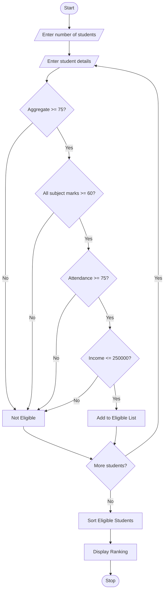

# University Scholarship Allocation System Using Python

## 1. Problem Statement
 University Scholarship Allocation: Design a system that evaluates applicants using aggregate 
marks, subject-wise minimum scores, attendance, and income criteria, ranks eligible students, and 
resolves ties using predefined rules

## 2. Algorithm

**Step 1:** Start the program.

**Step 2:** Enter the number of students.

**Step 3:** Read each student's:
- Name
- Aggregate marks
- Subject-wise marks
- Attendance percentage
- Annual family income

**Step 4:** Check eligibility conditions:
- Aggregate marks ≥ 75
- All subject marks ≥ 60
- Attendance ≥ 75
- Family income ≤ 250000

**Step 5:** If all conditions are satisfied, add the student to the eligible list.

**Step 6:** Sort eligible students using:
- Highest aggregate marks
- Highest attendance
- Lowest family income

**Step 7:** Display the eligible students with their ranks.

**Step 8:** Stop the program.

## 3. Flowchart (Mermaid)




## 5. Sample Input

```text
Enter number of students: 3

Enter details of student 1
Enter student name: Likith
Enter aggregate marks: 90
Enter subject 1 marks: 85
Enter subject 2 marks: 88
Enter subject 3 marks: 90
Enter attendance percentage: 95
Enter annual family income: 200000

Enter details of student 2
Enter student name: Rahul
Enter aggregate marks: 85
Enter subject 1 marks: 80
Enter subject 2 marks: 75
Enter subject 3 marks: 85
Enter attendance percentage: 90
Enter annual family income: 180000

Enter details of student 3
Enter student name: Kiran
Enter aggregate marks: 70
Enter subject 1 marks: 80
Enter subject 2 marks: 75
Enter subject 3 marks: 70
Enter attendance percentage: 85
Enter annual family income: 150000
```

## 6. Sample Output

```text
Kiran is Not Eligible

===== SCHOLARSHIP ALLOCATION RESULTS =====

Rank  Name       Aggregate  Attendance  Income

1 Likith 90.0 95.0 200000.0
2 Rahul 85.0 90.0 180000.0
```

