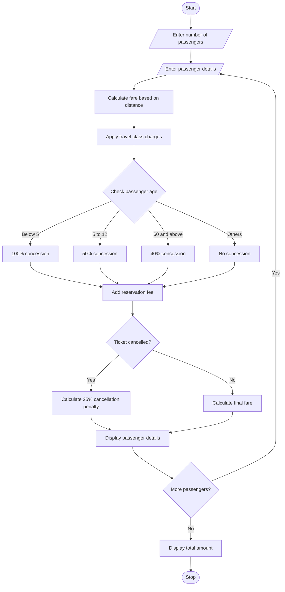

# Railway Fare and Reservation Calculator Using Python

## 1. Problem Statement
 Railway Fare and Reservation Calculator: Calculate fares for multiple passengers using distance 
slabs, travel classes, age-based concessions, reservation fees, and specified cancellation penalties. 
## 2. Algorithm

**Step 1:** Start the program.

**Step 2:** Enter the number of passengers.

**Step 3:** Enter passenger details:
- Name
- Age
- Distance
- Travel class

**Step 4:** Calculate the basic fare based on distance slabs.

**Step 5:** Calculate the fare based on travel class.

**Step 6:** Apply age-based concessions.

**Step 7:** Add the reservation fee.

**Step 8:** Calculate the final ticket fare.

**Step 9:** Ask whether the ticket is cancelled.

**Step 10:** If cancelled, calculate the cancellation penalty as 25% of the ticket fare.

**Step 11:** Display passenger-wise fare details and total amount.

**Step 12:** Stop the program.

## 3. Flowchart (Mermaid)


## 5. Sample Input

```text
Enter number of passengers: 2

Passenger 1
Enter passenger name: Likith
Enter age: 20
Enter distance in km: 200
1. Sleeper
2. AC 3 Tier
3. AC 2 Tier
Select travel class: 1
Is ticket cancelled? (yes/no): no

Passenger 2
Enter passenger name: Rahul
Enter age: 65
Enter distance in km: 200
1. Sleeper
2. AC 3 Tier
3. AC 2 Tier
Select travel class: 2
Is ticket cancelled? (yes/no): yes
```

## 6. Sample Output

```text
Passenger Name: Likith
Travel Class: Sleeper
Basic Fare: 250.0
Concession: 0 %
Reservation Fee: 50
Cancellation Penalty: 0
Final Fare: 300.0

Passenger Name: Rahul
Travel Class: AC 3 Tier
Basic Fare: 300.0
Concession: 40 %
Reservation Fee: 50
Cancellation Penalty: 87.5
Final Fare: 87.5

==============================
Total Railway Amount: 387.5
==============================
```


